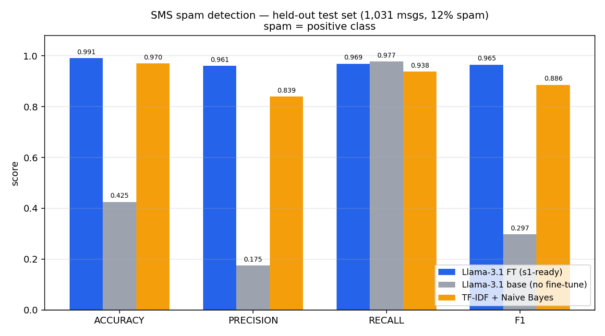

<div align="center">

# System 1 Ready (`s1-ready`)

**Describe a decision in one sentence, hand it raw text, get back a labeled dataset to fine-tune a fast decision model.**

[](https://github.com/mpetrenk/s1-ready/actions/workflows/ci.yml)
[](LICENSE)
[](https://www.python.org/downloads/)
[](pyproject.toml)

</div>

---

## What is a "System 1" model, and what is this for?

**S1 = System 1**, from Kahneman's two-system model of thinking: System 1 is the
fast, intuitive, single-pass judgment; System 2 is slow, deliberate reasoning. A
**System 1 model** answers one typed question about an input in a single forward
pass — no chain-of-thought, no essay. You give it a piece of text and it returns
a structured answer:

- **Route** this support ticket → `billing` / `sales` / `tech`
- **Flag** this message → spam? `yes` / `no`
- **Score** this incident → severity `1–5`
- **Tag** this review → `bug` / `feature-request` / `praise`
- **Triage** this email → urgent? `yes` / `no`

Models like **[Laya](https://github.com/NandhaKishorM/laya)** and small
Unsloth-fine-tuned classifiers do exactly this. Training one is cheap and fast.
**The hard part is the dataset** — correct labels, no train/test leakage,
balanced classes. That slow, careful prep is what `s1-ready` automates. (It's the
*System 2* work that earns you a fast *System 1* model.)

## You bring two things. You never write a label.

| You provide | Example |
|---|---|
| **A use case** — one sentence naming the decision | `"Flag whether an SMS message is spam"` |
| **Unlabeled text** — raw inputs, no answers attached | `messages.txt`, one message per line |

`s1-ready` figures out the question + answer options from your sentence, then
**writes the labels for you** (via an LLM teacher or a built-in heuristic),
removes train/test overlap, balances the classes, and exports a trainer-ready
file.

```python
from s1_ready import SchemaInferencer, DataForge, Labeler

# 1. One sentence → a typed question (here: a yes/no "is_spam" decision)
spec  = SchemaInferencer.from_prompt("Flag whether an SMS message is spam")

# 2. Point at raw, unlabeled text
forge = DataForge(spec).ingest("messages.txt")

# 3. Teachers write the labels; low-agreement rows are flagged for review
rows  = Labeler(teacher=["openai:gpt-4o-mini", "anthropic:claude-haiku-5-5"]).label(forge)

# 4. Decontaminate, balance, export → feed straight to Unsloth / TRL
rows.decontaminate(test_set).balance().to_jsonl("train.jsonl")
```

**No pre-existing labels required.** You start from unlabeled data; the labeled
dataset is the output.

## Does it actually work?

**Two results below: (1) fine-tuning + export on human labels, and (2) measured
automatic-labeling quality. The auto-label *fine-tune* comparison is the one
piece still pending. Read it honestly.**

A Llama-3.1 fine-tune (**Unsloth**, 4-bit LoRA, free Colab T4) on an SMS-spam
dataset exported by `s1-ready`, evaluated on a held-out test set:



| model | accuracy | precision | recall | **F1** |
|---|---:|---:|---:|---:|
| **Llama-3.1 fine-tuned** | **0.991** | **0.961** | **0.969** | **0.965** |
| Llama-3.1 base (no fine-tune) | 0.425 | 0.175 | 0.977 | 0.297 |
| TF-IDF + Naive Bayes (classical baseline) | 0.970 | 0.839 | 0.938 | 0.886 |

**What this shows:** fine-tuning on a clean, decontaminated, balanced dataset
(F1 0.297 → 0.965) and that `s1-ready`'s split/dedup/export pipeline feeds Unsloth
cleanly.

**What this does *not* yet show — and it's the main promise:** these training
labels are the **UCI corpus's human gold labels**, not labels `s1-ready`
generated. So this result validates the *fine-tuning + export* path, not the
*automatic labeling* path. Calling the dataset "s1-generated" would be false, so
we don't.

### Automatic labeling — measured

The headline promise (label an *unlabeled* corpus) is now tested, not just
scaffolded. Hiding the UCI human labels and having `s1-ready` generate them with
two teachers (`gpt-4o-mini` + `claude-haiku-5-5`), scored against the hidden gold
on 4,129 messages:

| labels | precision | recall | F1 |
|---|---:|---:|---:|
| raw consensus | 0.45 | 0.98 | 0.62 |
| **after agreement-gated review** (14% flagged) | **0.85** | 0.98 | **0.91** |

A single-pass LLM label is mediocre (F1 0.62); the **agreement signal flags the
14% of rows where the errors concentrate**, and the remaining 86% is near-clean
(F1 0.91). That is the review queue earning its place.

And it carries through to a **trained model**: fine-tuning Llama-3.1-8B on the
auto-labels (balanced ~1k rows) and scoring on the untouched human-labeled test
set —

| trained on | F1 |
|---|---:|
| base (no fine-tune) | 0.53 |
| s1-ready auto labels (raw) | 0.79 |
| **s1-ready auto labels (agreement-gated)** | **0.84** |
| human labels (ceiling) | 0.94 |

Fine-tuning on the auto-labels works (0.53 → 0.84), the agreement gate improves
the trained model (+0.06 F1 over raw), and there's an **honest −0.10 F1 price vs.
human labels** — automatic labeling got ~90% of the way, not all of it. (On this
lexically-easy task a classical TF-IDF baseline hits 0.91; the LLM route should
pay off more on harder tasks, untested here.) Full method, caveats, and the
five-way table: **[`auto_label/`](examples/case_study/auto_label/README.md)**.

Full method + honest "when is this worth it vs. classical ML":
**[case study](examples/case_study/CASE_STUDY_sms_spam.md)** · reproduce in
**[Colab](examples/case_study/s1_spam_colab.ipynb)**.

## Install

> **Not on PyPI yet** — install from source until the first release.

```bash
pip install "git+https://github.com/mpetrenk/s1-ready.git"          # core, zero deps
pip install "s1-ready[llm] @ git+https://github.com/mpetrenk/s1-ready.git"  # + LLM teachers
```

Core has **zero runtime dependencies** (pure stdlib + a built-in heuristic
teacher), so it runs with no API keys. `[llm]` adds OpenAI / Anthropic / Bedrock
teachers. Once a release is on PyPI this becomes the usual `pip install s1-ready`.

## How it works

```
use case sentence ─▶ schema ─▶ forge ─▶ label ─▶ gates ─▶ train.jsonl
   "flag spam"       question   ingest   multi-   decon-    typed /
                     + options  corpus   teacher  taminate  unsloth /
                                synth.   consensus balance  conversational
```

| Stage | Does |
|---|---|
| **Schema** | Turns your sentence into a typed question — `choice` / `bool` / `score` — with options. |
| **Forge** | Ingests your corpus; synthesizes in-distribution fillers to balance sparse classes. |
| **Label** | Labels each row with one or more teachers; records an **agreement score** per row. |
| **Gates** | **Decontaminates** train/test overlap, balances classes, filters low-confidence rows. |
| **Export** | Writes `train.jsonl` in typed / Unsloth / ShareGPT / raw formats (+ a `.spec.json` sidecar). |

The **agreement score + review queue** are first-class: rows where teachers
disagree are flagged for human spot-check, not silently trusted. Route that queue
to a reviewer for regulated use cases.

## Quickstart (CLI)

```bash
s1-ready prepare \
  --use-case "Route support tickets to a team and flag refunds" \
  --corpus tickets.txt \
  --synthesize 500 \
  --teacher heuristic \
  --out train.jsonl
```

Zero keys needed with `--teacher heuristic`. Swap in `openai:gpt-4o-mini`,
`anthropic:claude-haiku-5-5`, a local model, or your own callable for real
labels. (`s1ready` is a shorter alias for the same command.)

## Built for decision models

A decision model takes a state (text, email, ticket, JSON) + typed questions and
returns a structured answer in one pass — no free-text generation. `s1-ready`
produces the data those models fine-tune on:

- **[Laya](https://github.com/NandhaKishorM/laya)** — open-source, fine-tunable
  System 1 decision model. Its own docs: *fine-tuning is where most of the value
  is.* `s1-ready` emits exactly the typed-decision rows it trains on.
- **[Unsloth](https://github.com/unslothai/unsloth) / TRL / Axolotl** — roll your
  own small classifier; export straight to their formats.
- **[Jev](https://www.anth.us/blog/fine-tuning-jev/)** (TypeSafe AI) named this
  model category but is hosted and can't be fine-tuned — `s1-ready` targets the
  open, trainable side.

<details>
<summary><b>Scope — what it is and isn't built for</b></summary>

<br>

Works for any task framable as a **decision over a text input**. A decision is
one of three shapes:

- **choice** — pick one option from a set (routing, triage, tagging, intent)
- **bool** — a yes/no flag (is-refund, is-urgent, is-spam)
- **score** — a bounded rating (priority 1–5, severity, risk)

**Not built for:** open-ended generation (no single gold answer to vote on),
multi-step reasoning / tool-use traces (this is System 1, single-pass), or
non-text inputs (states are strings).

Two honest qualifiers: schema inference is heuristic — it *proposes* the question
+ options, so review or hand-write the option set for anything serious. And
"decision-based" means the data has a decision attached — raw narrative text
isn't a use case until you define what to decide about it. Confirm the schema for
anything regulated.

</details>

<details>
<summary><b>Teachers — model-agnostic, bring any LLM</b></summary>

<br>

The teacher drives schema inference and labeling. Prompts and parsing are plain,
vendor-neutral text — any instruction-following LLM works.

| `teacher` | Backend |
|---|---|
| `heuristic` (default) | zero-dependency, offline, no key |
| `openai:gpt-4o-mini` | OpenAI (`OPENAI_API_KEY`) |
| `openai:<model>@http://localhost:11434/v1` | any OpenAI-compatible endpoint (Ollama, vLLM, LM Studio, Together, Groq, Azure) |
| `anthropic:claude-haiku-5-5` | Anthropic direct (`ANTHROPIC_API_KEY`), no AWS — use whatever id `models.list()` returns for your account |
| `bedrock:anthropic.claude-3-haiku-...` | AWS Bedrock (AWS creds) |
| a Python callable `fn(prompt)->str` | bring your own: local HF pipeline, internal gateway, anything |

```python
# Local model via Ollama, no cloud, no key:
spec = SchemaInferencer.from_prompt(use_case, teacher="openai:llama3@http://localhost:11434/v1")

# Fully custom backend:
def my_model(prompt: str) -> str: ...
spec = SchemaInferencer.from_prompt(use_case, teacher=my_model)
```

If a teacher is unavailable or returns garbage, schema inference falls back to the
heuristic rather than failing.

</details>

<details>
<summary><b>Schema inference — validated on a 100-case benchmark</b></summary>

<br>

Sentence → questions + options is the step most tools get wrong, so it ships with
a committed **100-case benchmark**
([`examples/schema_benchmark/`](examples/schema_benchmark/)) across
choice/bool/score, single/multi-question, varied domains and phrasings.

| path | score | notes |
|---|---:|---|
| heuristic (default, zero-dep) | **100 / 100** | regex + keyword rules, tuned against this set |
| LLM (`openai:gpt-4o-mini`) | **96 / 100** | extraction prompt; of 4 misses, 2 defensible, 1 cosmetic, 1 real — ~99 on a fair read |

Runs as a `pytest` regression gate so neither path can silently degrade.

```bash
python examples/schema_benchmark/run_benchmark.py                       # heuristic
S1_BENCH_TEACHER="openai:gpt-4o-mini" python examples/schema_benchmark/run_benchmark.py  # LLM
```

Honest caveat: the heuristic's 100/100 partly reflects gold written against its
expected behavior; the LLM path was scored cold and generalizes better to unseen
phrasings. Review inferred schemas for anything high-stakes.

</details>

<details>
<summary><b>Export formats + training handoff</b></summary>

<br>

Pick with `--format` (CLI) or `fmt=` (library). All newline-delimited JSON.

| `--format` | Shape | For |
|---|---|---|
| `typed-decisions` | `{state, questions, gold, agreement, synthetic}` | native; Laya / Strands-style models |
| `unsloth` | `{instruction, input, output}` (Alpaca) | Unsloth / TRL / Axolotl SFT |
| `conversational` | `{conversations: [user, assistant]}` (ShareGPT) | Unsloth default; TRL |
| `raw` | `{state, gold}` | minimal / custom harnesses |

Every export also writes a `<out>.spec.json` sidecar with the schema.

Add `--emit-helper` (for `unsloth` / `conversational`) to also generate a
ready-to-run `<out>.train.py` with the `SFTTrainer` boilerplate — you edit only
the base model id.

```bash
s1-ready prepare --use-case "..." --corpus tickets.txt \
  --format conversational --emit-helper --out train.jsonl
# writes: train.jsonl, train.jsonl.spec.json, train.jsonl.train.py
```

</details>

## Development

```bash
git clone https://github.com/mpetrenk/s1-ready.git
pip install -e "s1-ready[dev]"
cd s1-ready && pytest -q    # 18 passed, 1 skipped (LLM-only test)
```

## License

MIT — see [LICENSE](LICENSE).
