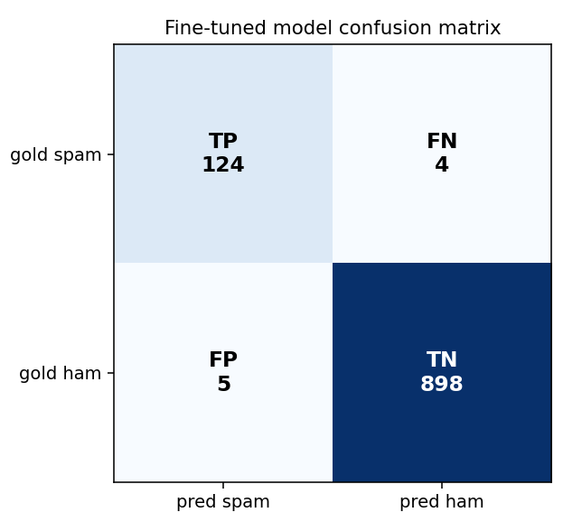

# Case study: SMS spam detection

**Claim under test:** can `s1-ready` take a plain decision ("is this SMS spam?")
and a raw text corpus, and produce a dataset that fine-tunes a usable System 1
classifier — on a free Colab GPU?

**Answer:** yes. End to end, measured on a held-out test set. This page shows
the real numbers, the honest comparison against two baselines, and where the
approach does and does not pay off.

## Setup

| | |
|---|---|
| **Dataset** | [UCI SMS Spam Collection](https://archive.ics.uci.edu/dataset/228/sms+spam+collection) (CC BY 4.0), 5,574 real SMS messages |
| **Decision** | `is_spam` (bool) |
| **Labels** | the dataset's real human gold labels (not LLM-generated) |
| **Dedup + split** | 414 duplicate messages removed, then a stratified 80/20 split so train and test share **zero** messages |
| **Train** | 1,028 rows, balanced 514 spam / 514 ham, ShareGPT format via `s1-ready --format conversational` |
| **Test** | 1,031 rows, **unbalanced** 128 spam / 903 ham (real-world ratio) |
| **Model** | `unsloth/llama-3.1-8b-instruct-bnb-4bit`, LoRA, 1 epoch |
| **Hardware** | free Google Colab T4 GPU, a few minutes |

Reproduce the data build:

```bash
python examples/build_sms_spam.py SMSSpamCollection \
  --balance --holdout 0.2 --seed 7 --out examples/sms_spam.jsonl
```

Train + eval + compare, one click: open
**[`s1_spam_colab.ipynb`](s1_spam_colab.ipynb)** in Colab (upload the two data
files when prompted). The individual cells also live in
[`examples/`](../) (`sms_spam.jsonl.train.py`, `eval_cell.py`, `compare_cell.py`).

## Results


| model | accuracy | precision | recall | F1 |
|---|---:|---:|---:|---:|
| **Llama-3.1 fine-tuned (s1-ready)** | **0.991** | **0.961** | **0.969** | **0.965** |
| Llama-3.1 base (no fine-tune) | 0.425 | 0.175 | 0.977 | 0.297 |
| TF-IDF + Naive Bayes | 0.970 | 0.839 | 0.938 | 0.886 |

Fine-tuned model confusion matrix (spam = positive):



Out of 1,031 held-out messages: 4 spam slipped through, 5 legit messages were
wrongly flagged, everything else correct.

## What the numbers mean

**1. The s1-ready dataset is the entire difference.** The *same* base model,
prompted the *same* way, scores **F1 0.297 untrained → 0.965 fine-tuned**. The
only thing that changed is the training data `s1-ready` produced. (The base
model's deceptively high recall of 0.977 is a trap: it calls almost everything
spam, so its precision collapses to 0.175 — it isn't classifying, it's guessing
one label.)

**2. The pipeline produces a genuinely usable model.** 96.9% of spam caught with
a 0.5% false-alarm rate on unseen messages, from a few minutes of training.

**3. Honest limit — this task is easy, and classical ML is close.** TF-IDF +
Naive Bayes, trained in *seconds on CPU*, reaches F1 0.886. The fine-tuned LLM
wins — most clearly on **precision** (0.961 vs 0.839, i.e. far fewer good
messages wrongly blocked) — but the gap is modest and the compute cost is not.

## When is the s1-ready / LLM route worth it?

- **Not** for a clean, single binary decision with lots of labeled data and
  obvious keyword features — classical ML is cheaper and nearly as good. This
  spam demo proves the *mechanics*, not that an LLM is the right tool for *this*
  job.
- **Yes** when the decision is harder than bag-of-words: many options
  (multi-team routing), several questions at once, nuance / paraphrase /
  sarcasm, or domains where you have raw text but no labels and no time to
  hand-engineer features. That is exactly the gap `s1-ready` closes — it
  generates the labeled, calibrated, decontaminated option data that such a
  model needs, which is otherwise the expensive bottleneck.

## Takeaway

`s1-ready` did its job: a one-sentence decision + a raw corpus became a
decontaminated, balanced, trainer-ready dataset, and that dataset turned a
general LLM into a working spam classifier (F1 0.297 → 0.965) on free hardware.
The honest framing is that the value scales with task difficulty — and the whole
loop is measurable, which is the point.
